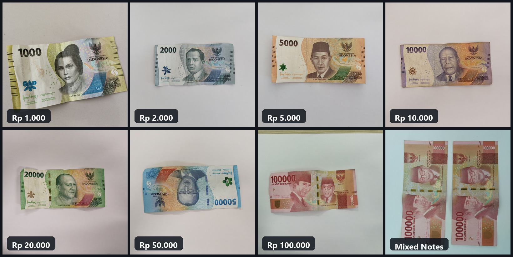

# Rupiah Banknotes Dataset (Indonesian Currency)

<p align="center">
  
</p>

<p align="center">
  <a href="https://www.kaggle.com/datasets/mkaspulanwar/rupiah-banknotes-dataset">
    
  </a>
  <a href="https://www.kaggle.com/code/mkaspulanwar/rupiah-banknotes-eda-pytorch-resnet18-starter">
    
  </a>
  <a href="LICENSE">
    
  </a>
  
  
</p>

A curated, real-world image dataset of **Indonesian Rupiah banknotes (Rp1,000 – Rp100,000)** in high-resolution **JPG format**, photographed directly by **M. Kaspul Anwar, Muhammad Lutfan, and Andri Rahmadani**, designed for Machine Learning (ML) and Computer Vision (CV) research, benchmarking, and assistive technology prototypes.

> **Where are the image files?**
> To keep this GitHub repository lightweight and fast to clone, the full **3.74 GB (1,392 JPG images)** dataset is hosted on **[Kaggle Datasets](https://www.kaggle.com/datasets/mkaspulanwar/rupiah-banknotes-dataset)**. This repository serves as the companion codebase containing download utilities, dataset splitters, statistics scripts, and starter notebooks.

---

## Dataset Overview & Class Distribution

All images are **original real-world photographs** (no synthetic or AI-generated images) captured across varied angles, lighting conditions, folds, and backgrounds.

| Folder | Denomination | Images | Size |
| :--- | :--- | ---: | ---: |
| `idr_1000/` | Rp1,000 | 166 | 460.3 MB |
| `idr_2000/` | Rp2,000 | 178 | 398.4 MB |
| `idr_5000/` | Rp5,000 | 167 | 384.0 MB |
| `idr_10000/` | Rp10,000 | 156 | 430.5 MB |
| `idr_20000/` | Rp20,000 | 189 | 492.4 MB |
| `idr_50000/` | Rp50,000 | 202 | 612.0 MB |
| `idr_100000/` | Rp100,000 | 191 | 574.2 MB |
| `idr_mix/` | Mixed / multiple banknotes | 143 | 476.4 MB |
| **Total** | **8 folders** | **1,392** | **3.74 GB** |

---

## Quick Start

### 1. Download in 1 Line with `kagglehub`

```bash
pip install kagglehub
```

```python
import kagglehub

path = kagglehub.dataset_download("mkaspulanwar/rupiah-banknotes-dataset")
print("Dataset downloaded to:", path)
```

Or use the included CLI helper script:

```bash
git clone https://github.com/anwarpage/rupiah-banknotes-dataset.git
cd rupiah-banknotes-dataset
pip install -r requirements.txt

# Download and copy class folders into ./data
python scripts/download.py --output ./data
```

### 2. Inspect Stats & Create Train/Val/Test Splits

```bash
# View per-class counts and sizes
python scripts/stats.py --source ./data

# Create stratified 70% train / 15% val / 15% test splits (7 single denominations)
python scripts/split_dataset.py --source ./data --output ./splits
```

### 3. Load with PyTorch

```python
from torchvision import datasets, transforms
from torch.utils.data import DataLoader

transform = transforms.Compose([
    transforms.Resize((224, 224)),
    transforms.ToTensor(),
])

train_ds = datasets.ImageFolder("splits/train", transform=transform)
train_loader = DataLoader(train_ds, batch_size=32, shuffle=True)
print(train_ds.class_to_idx)
```

### 4. Load with TensorFlow / Keras

```python
import tensorflow as tf

train_ds = tf.keras.utils.image_dataset_from_directory(
    "splits/train",
    image_size=(224, 224),
    batch_size=32,
)
```

Check out the full walkthrough in [`examples/rupiah_banknotes_starter.ipynb`](examples/rupiah_banknotes_starter.ipynb) or run it directly on **[Kaggle](https://www.kaggle.com/code/mkaspulanwar/rupiah-banknotes-eda-pytorch-resnet18-starter)**.

---

## Repository Structure

```text
rupiah-banknotes-dataset/
├── README.md
├── LICENSE
├── requirements.txt
├── assets/
│   └── cover_collage.jpg                  # 2x4 visual preview of all classes
├── scripts/
│   ├── download.py                        # Download dataset from Kaggle via kagglehub
│   ├── split_dataset.py                   # Stratified train/val/test splitter
│   └── stats.py                           # Class count, size & resolution stats
└── examples/
    └── rupiah_banknotes_starter.ipynb     # Starter EDA & PyTorch ResNet18 notebook
```

---

## Use Cases

- **Image Classification:** Train CNNs or Vision Transformers (MobileNetV3, ResNet, EfficientNet, ViT) to recognize Indonesian Rupiah denominations.
- **Object Detection:** Annotate bounding boxes (e.g., for YOLO) to localize multiple banknotes in real-world scenes (`idr_mix/`).
- **Assistive Technology:** Prototype mobile/edge currency readers for visually impaired users.
- **Education & Benchmarking:** End-to-end computer vision workflows from preprocessing to deployment.

---

## Citation

If you use this dataset in academic work, theses, or projects, please cite:

```bibtex
@misc{rupiah-banknotes-dataset,
  author       = {M. Kaspul Anwar and Muhammad Lutfan and Andri Rahmadani},
  title        = {Rupiah Banknotes Dataset (Indonesian Currency)},
  year         = {2025},
  howpublished = {\url{https://www.kaggle.com/datasets/mkaspulanwar/rupiah-banknotes-dataset}},
  note         = {Companion repository: \url{https://github.com/anwarpage/rupiah-banknotes-dataset}}
}
```

---

## Ethics & Responsible Use

1. **Legality:** Ensure your usage complies with applicable laws regarding currency images in your jurisdiction.
2. **No Counterfeiting:** This dataset is strictly for academic research, education, and legitimate computer vision applications. It **must not** be used for counterfeiting, fraud, or any illegal financial activity.
3. **Attribution:** Please credit the authors using the citation above when publishing results or derivative work.
4. **High-Stakes Deployment:** Do not deploy models trained solely on this dataset in production financial systems without rigorous validation and anti-spoofing safeguards.

---

## Contributing & Support

Contributions are welcome! Open an issue or pull request to contribute:
- Benchmark notebooks (YOLO, EfficientNet, MobileNet, TFLite/ONNX edge models)
- Bounding-box annotations for `idr_mix/`
- Additional photos (e.g., newer emission series or varied lighting environments)

<p align="center">
  <a href="https://blockstream.info/address/bc1q9jc7wnggqhuq7lqx29u49t3pv5ftk5lmwpl6k4" target="_blank">
    
  </a>
</p>

---

## License

Released under the [MIT License](LICENSE).
